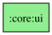

# :core:ui module
## Dependency graph

`:core:ui` re-exports `:core:designsystem` with `api`; theme, tokens and generic components live there (see its README). What remains here is adaptive layout, saved state, modifiers, scrollbars, pickers and product images.
