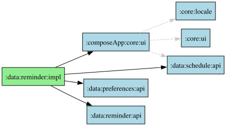

# :data:reminder:impl module

## Dependency graph

## Platform quirks — local notification reminders

### Scheduling model

| | Android | iOS | JVM |
|---|---|---|---|
| **Phases** | Two-phase | One-phase | Two-phase |
| **Scheduler** | `AlarmManager` + `PendingIntent` | `UNUserNotificationCenter.addNotificationRequest()` | `ScheduledExecutorService` |
| **Display trigger** | `ClassReminderReceiver` (BroadcastReceiver) receives alarm → builds notification | System displays automatically when `UNCalendarNotificationTrigger` fires | Timer callback → `EventReminderNotifier` |
| **Reschedule** | Manual: receiver calls `scheduleReminder()` again | Automatic: `repeats = true` does it | Manual: timer callback reschedules |
| **Content building** | At display time in `EventReminderNotifier` | At scheduling time in `UNMutableNotificationContent` | At display time in `EventReminderNotifier` |

### Time calculation (30-minute advance)

| | Android | iOS | JVM |
|---|---|---|---|
| **Method** | `calculateAlarmTime()` in impl | `reminderTimeInfo` from common API | `calculateAlarmTime()` in impl |
| **Unit** | Epoch millis | `NSDateComponents` (hour, minute, weekday) | Epoch millis |
| **Wrap handling** | `DateTimeUnit.MINUTE` subtraction on `Instant` — handles day crossing naturally | Common `ReminderTimeInfo` computes `(hour, minute, weekdayOffset)` — `weekdayOffset: -1` when wrapping past midnight | Same as Android |

### Permissions

| | Android | iOS | JVM |
|---|---|---|---|
| **Notification permission** | `POST_NOTIFICATIONS` (Android 13+), via moko-permissions | `requestAuthorizationWithOptions([.alert, .sound, .badge])` via `UNUserNotificationCenter` | None needed |
| **Alarm permission** | `SCHEDULE_EXACT_ALARM` (Android 12), via Settings intent | Not applicable — no alarm concept. `hasAlarmPermission()` always returns `true` | Not applicable |
| **Foreground display** | Always shows | **Requires delegate**: `UNUserNotificationCenter.current().delegate` must implement `willPresent` calling `completionHandler([.banner, .sound, .badge])`. Set in `iosApp/iosApp/iOSApp.swift`. | N/A (desktop notification tool) |

### Key iOS-specific gotchas

| Gotcha | Detail |
|---|---|
| **`NSCalendar.currentCalendar` required** | `NSDateComponents` must have `calendar` set, otherwise the `UNCalendarNotificationTrigger` is silently ignored and the notification never fires. |
| **Weekday mapping** | Gregorian: 1=Sunday … 7=Saturday. Common `ReminderTimeInfo` converts from ISO day numbers. |
| **64 notification limit** | Apple limits pending notifications to 64 per app. Beyond that, `addNotificationRequest` succeeds but the request is not added. |
| **No `EventReminderNotifier`** | iOS doesn't need this class — notification content is set at scheduling time. The common `expect` was removed. |
| **Foreground notifications** | Silent unless `UNUserNotificationCenterDelegate.willPresent` is implemented (see above). |

### Common (all platforms)

- **30-minute advance**: `EventReminderWithTime.reminderTimeInfo` computes the offset in shared code. Returns `(hour, minute, weekdayOffset)` where `weekdayOffset = -1` when wrapping past midnight (e.g., event at 00:15 → reminder at 23:45 previous day).
- **`EventReminderNotifier`**: Platform-internal class (not expect/actual). Used by Android (`ClassReminderReceiver`) and JVM (timer callback); absent on iOS.
- **String resources**: Shared via Compose Multiplatform resources in `commonMain/composeResources/`. All three locales (EN, ES, JA) include placeholders for event name, start time, and location.
