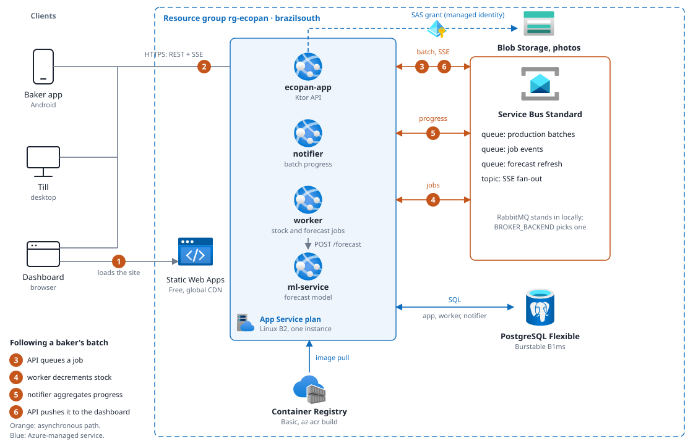

# infra — Azure deployment



The whole ecopan stack on Azure App Service and Azure Service Bus: Bicep plus one bash script, no
`azd`.

```shell
az login
./infra/deploy.sh          # ~20 min cold, prints the public URLs
./infra/teardown.sh        # delete everything
```

---

### One command: deploy if needed, then the production clients

```shell
scripts/prod-up.sh                 # deploys only if nothing is deployed, then builds + launches the release Android app and desktop till
scripts/prod-up.sh --check         # is there a healthy deployment? (exit 0/1)
scripts/prod-up.sh --redeploy      # run deploy.sh again even if deployed
./infra/deploy.sh --launch-clients # the other way round: deploy, then launch the clients
```


## Why this shape, and why it changed

An earlier revision of this directory ran the stack on **Container Apps with a self-hosted RabbitMQ
container**, and argued that App Service was impossible. That argument was correct about App
Service and wrong about the premise. Both halves are worth keeping, because the second is the more
useful lesson.

### The constraint that was real

`backend/data`'s original broker clients spoke **AMQP 0-9-1 on TCP 5672**. From the App Service
docs:

> "App Service currently allows your container to expose only **one port for HTTP requests**."
> — *Configure a custom container for Azure App Service*
>
> "Can I expose more than one port on my custom container image? **This isn't supported.**"
> — *App Service on Linux FAQ*

That is not negotiable, and it is genuinely why a self-hosted RabbitMQ cannot live on App Service.

### The premise that was wrong

The conclusion drawn from it was "therefore Container Apps". The unexamined assumption was that
*the broker must be a container we run*. It doesn't have to be. Azure sells the broker as a managed
service, and the numbers were already in the old version of this file:

> If we were willing to swap RabbitMQ for Azure Service Bus, App Service B1/B2 would likely be the
> cheapest option.

It was treated as a rewrite too large to justify. It wasn't. The four broker interfaces
(`ProductionBatchBroker`, `BatchEventBroker`, `ForecastRefreshBroker`, `SsePushBroker`) already
existed and every consumer already depended on the interface rather than the implementation, so a
second family slotted in underneath with **no change to a single caller**. The port constraint was
real; treating it as architecture-defining was the error.

### What that buys

- **No broker to run.** No container, no replica, no patching, no "what happens when the broker
  restarts" paragraph. Service Bus is Microsoft's problem.
- **App Service becomes possible**, and its per-plan billing is the cheapest thing here.
- **A real dead-letter queue for free.** Every Service Bus queue has one. The RabbitMQ path builds
  the equivalent out of a dead-letter exchange plus a dead-letter queue plus matching bindings that
  producer and consumer must declare identically or the broker rejects the redeclare.
- **`maxDeliveryCount` covers a case the manual nack cannot** — a consumer that crashes mid-message
  and never nacks at all. RabbitMQ redelivers on connection loss; Service Bus counts deliveries and
  dead-letters by itself.

### What it costs

- **`RootManageSharedAccessKey`, not Send+Listen.** The SSE fanout creates and deletes a
  subscription per app instance at runtime, and that is a management operation. A tighter rule
  would break SSE scale-out. Tradeoff taken knowingly; see the SSE section below.
- **No private path between apps.** Covered in *Deliberate tradeoffs*.
- **Vendor lock-in for this deployment.** Mitigated exactly as far as it needs to be: RabbitMQ is
  still the default, still what `docker compose up` runs, and still fully tested. One env var
  switches back.

---

## Both brokers, one build

```
backend/data/.../messagebroker/
├── ProductionBatchBroker.kt      ┐
├── BatchEventBroker.kt           │ four interfaces — the only thing callers see
├── ForecastRefreshBroker.kt      │
├── SsePushBroker.kt              ┘
├── rabbitmq/                     kourier, AMQP 0-9-1  — the default
├── servicebus/                   azure-messaging-servicebus 7.17.19
└── di/MessageBrokerModule.kt     picks a family from BROKER_BACKEND
```

Both families are on the classpath of every image. Which one runs is decided at startup from one
environment variable, so the image running in Azure is byte-identical to the one running under
`docker compose`:

```shell
BROKER_BACKEND=rabbitmq       # default; omit entirely and you get this
BROKER_BACKEND=service_bus    # + SERVICE_BUS_CONNECTION_STRING
```

### How the semantics map

| | RabbitMQ | Service Bus |
|---|---|---|
| Work queue | direct exchange + queue + binding | queue (no exchange concept) |
| Dead letter | declared DLX + DLQ + binding | built-in sub-queue |
| Retry limit | none — manual nack only | `maxDeliveryCount` |
| Backpressure | `basicQos(prefetch)` | `maxConcurrentCalls` |
| Settle on success | `basicAck` | `context.complete()` |
| Settle on failure | `basicNack(requeue=false)` | `context.deadLetter()` |
| Fanout | fanout exchange + exclusive auto-delete queue | topic + per-instance subscription |
| At-most-once | `noAck = true` | `RECEIVE_AND_DELETE` |
| Consumer shape | hand-rolled `for (delivery in consumer)` loop | `ServiceBusProcessorClient` |

`ServiceBusProcessorClient` is the closest thing outside Azure Functions to a **Service Bus
trigger**: register a `processMessage` callback and the client owns the receive loop, the lock
renewal and the reconnects. The kourier implementation has to hand-roll all three.

### The one hop that is not a clean swap: SSE fanout

RabbitMQ gives an exclusive, auto-delete queue a lifecycle bound to its connection — the broker
destroys it the moment the consumer disconnects. Service Bus subscriptions are durable and outlive
their client, so that lifecycle is reconstructed from two halves:

1. **Clean shutdown** deletes the subscription in a `finally` (under `NonCancellable`, or the
   delete would itself be cancelled and every restart would leak one).
2. **Unclean shutdown** is caught by `autoDeleteOnIdle`, whose floor Azure sets at **5 minutes**.

Between a crash and that timer, an orphaned subscription accrues pushes nobody will read. Every
message carries a 5-minute TTL, so it drains as fast as it fills. Acceptable because this hop is
best-effort by design — the persisted notification tray, not the broker, is the durable record.

---

## Cost

Real retail rates pulled from the Azure Retail Prices API for `brazilsouth` while writing this.

| Resource | SKU | ~USD/mo |
|---|---|---|
| App Service Plan (Linux) | **B2** — 2 vCPU, 3.5 GB | 29.93 |
| PostgreSQL Flexible Server | B1ms burstable, 32 GB, no HA | 25.55 + ~4 storage |
| Service Bus | Standard, 12.5M ops included | 10.00 |
| Container Registry | Basic ($0.1666/day) | 5.07 |
| Static Web App | Free | 0 |
| **Total** | | **~$75** |

**Four apps, one plan.** That is the whole economy: an App Service Plan bills per plan, not per
app, so the marginal cost of the worker, the notifier and the ML service is zero. Container Apps
bills every replica separately and ran $22 idle / $73 active for the same four — *plus* a fifth
replica for the broker.

**Why B2 and not B1** ($14.60, and $15/month is real money against a $100 credit): B1 has 1.75 GB
for three JVMs and a LightGBM process sharing one instance. It does not fit. The heap caps in
`apps.bicep` (`-Xmx640m` / `512m` / `384m`) exist because App Service does not cgroup-limit each
app separately — all four share the instance's memory, and a JVM left to size itself from `/proc`
claims a quarter of the machine as its own share. If you want to try B1 anyway:
`./infra/deploy.sh` after setting `planSku` to `B1`, and expect the ML service to be the first
thing OOM-killed.

**Where the money actually goes.** PostgreSQL is 40% of the bill and the only resource with a real
pause: `az postgres flexible-server stop` drops it to ~$4/mo of storage. `teardown.sh --stop-only`
does that and downscales the plan to B1, landing at ~$34/mo — the plan, Service Bus and the
registry keep billing regardless. **On a $100 student credit, deleting the group between sessions
is better value than pausing it**; a rebuild is 20 minutes.

---

## Region: Brazil South, and why not Chile Central

Chile Central is the better fit on every technical axis — Santiago, for a client whose app is
`es-CL` / `America/Santiago` / CLP — and it is cheaper for the database ($0.0238/h vs $0.035/h,
~$8/month).

**It is nonetheless blocked.** This tenant enforces a management-group Azure Policy
(`Ubicaciones permitidas` — the built-in *Allowed locations*) whose allowlist is:

```
brazil, brazilsouth, brazilsoutheast, brazilus, eastus, eastus2, global,
northcentralus, southcentralus, unitedstates, westcentralus, westus, westus2, westus3
```

`chilecentral` is absent, so **every resource is denied at deploy time** with
`RequestDisallowedByPolicy`. This was found by running `az deployment group validate` — the
template compiles perfectly and fails only against the live subscription. If your administrator
adds `chilecentral`, switch with `./infra/deploy.sh --location chilecentral`; nothing else changes.

Static Web Apps is not offered in either South American region (its control plane lives in
`eastus2`, `centralus`, `westus2`, `westeurope`, `eastasia`), so that one resource is created in
`eastus2`. Cosmetic — content serves from a global CDN, not from Virginia.

---

## Topology

```
                         Internet
                            │
             ┌──────────────┴──────────────┐
             │                             │
      Static Web App                 ecopan-app  ── HTTPS + SSE
      (webApp, Free, eastus2)              │
                                           │
   ── App Service Plan B2 (one Linux instance, four apps) ──
             │              │              │            │
        ecopan-app   ecopan-worker  ecopan-notifier  ecopan-ml
             │              │              │            ▲
             └──────────────┼──────────────┘            │
                            │                    (plan outbound IPs
                   Azure Service Bus              only + API key)
              production · batch.events
              forecast.refresh · notifications.sse
                            │
              PostgreSQL Flexible (public + firewall)
```

`ecopan-worker` and `ecopan-notifier` are headless queue consumers. They run a ten-line
`com.sun.net.httpserver` health listener (`backend/data/.../core/HealthEndpoint.kt`) for exactly
one reason: App Service polls a Linux container's port at startup and restarts it if nothing
answers, forever, however healthy the consumer inside is.

`alwaysOn: true` on all four is likewise not optional. Without it App Service unloads an app after
20 minutes idle and wakes it on an inbound HTTP request — which an API survives and a queue
consumer does not, because messages do not arrive over HTTP. Basic is the cheapest tier offering
`alwaysOn`, so **Free and Shared tiers are unusable for this stack at any price.**

---

## How deploy.sh works

Two Bicep phases with an image build in between, because the apps need images and images need a
registry that Bicep creates:

1. **`foundation.bicep`** — registry, Service Bus namespace (+ 3 queues and 1 topic), PostgreSQL.
2. **`az acr build` ×4** — builds server-side. No local Docker, and it produces `linux/amd64`,
   which matters on an Apple-silicon laptop: a locally built arm64 image pushes fine and then fails
   to start with an exec-format error that reads like a crash loop.
3. **`apps.bicep`** — the plan and the four web apps.
4. **Post-deploy patches** that cannot be expressed in a template because they depend on values
   assigned at create time: the ML service's IP allowlist (the plan's own outbound IPs), and the
   backend's CORS allowlist (the Static Web App hostname).
5. **Static Web App** — `npm run build` with `VITE_API_BASE_URL` baked in, uploaded via the SWA CLI.

Secrets (`PG_PASSWORD`, `JWT_SECRET`, `ML_API_KEY`) are generated with `openssl rand` on first run
and cached in `infra/.env.local`, which is **gitignored**. Re-running reuses them, so a redeploy
does not rotate the database password out from under a live server. The Service Bus connection
string is not generated — it is read back from the namespace, so it never needs storing.

### ML model

The ML image carries the trained LightGBM model (`ml/data/artifacts`: `model.txt` ~23 MB plus
`metadata.json` and `encoding.json`). The files are gitignored, so there are two ways a deploy could
get them; this repo picks the first:

1. **Build on a machine that has the artifact** (chosen). `az acr build` uploads `ml/` as the build
   context and `ml/.dockerignore` allowlists the three files the service loads. No second
   distribution channel, nothing to publish or keep in sync, and the model deployed is the one
   sitting next to the `RESULTS.md` it was scored for.
2. A CI-downloaded GitHub release asset. Rejected for now: it would let the deployed model drift
   from the one in `RESULTS.md`, and the artifact changes a few times per project, not per deploy.

Consequences, deliberately loud:

- A local `deploy.sh` stops in preflight if `ml/data/artifacts/{model.txt,metadata.json,
  encoding.json}` are missing, and the Dockerfile stops the build if they are missing or do not load.
  `--ml-baseline-only` ships a model-less image on purpose (the Dockerfile then copies no artifact
  even if one is present).
- **The GitHub `deploy` workflow's runner never has the artifact**, so it passes `--ml-skip-build`:
  every other image is rebuilt, but `ecopan/ml-service:latest` is neither rebuilt nor overwritten —
  it is re-tagged (`az acr import`) with the deploy's tag. Ticking `ml_baseline_only` is the only
  way CI pushes an ML image, and it is baseline-only. The first-ever deploy must therefore come from
  a machine with the model. `--skip-build` skips *all* builds and deploys the tag
  `$ECOPAN_IMAGE_TAG` (default: current git SHA), which must already exist in the registry.
- After rollout `deploy.sh` polls the ML service's `GET /health`. When the run built the ML image it
  **fails the deploy unless `/health` reports `model_loaded:true`** (`false` for
  `--ml-baseline-only`); when it did not (`--ml-skip-build`, `--skip-build`) it only reports what is
  deployed and warns if that is baseline-only. The service is IP-allowlisted to the plan, so the
  script opens a rule for the deployer's IP for the probe only (an `EXIT` trap removes it, warning
  with the manual command if removal fails). If the deployer's IP cannot be determined the check is
  skipped with a warning instead of failing a deploy that has already rolled out.
- The service serves the model only for branch/product keys the model was trained on; the bakery's
  own series are served by the baseline (`ml/RESULTS.md` §4.7). The deploy check proves the image
  carries the model, not that bakery forecasts come from it.

### Demo data: Azure ends up in the state `scripts/demo-up.sh` leaves the local stack in

By default `deploy.sh` copies the **local** catalog, users, formulas and uploaded product photos
into Azure (`infra/import-local.sh`, needs local Docker), then runs the same opening-stock and
`DEMAND_FORECASTING` steps against the deployed API (`scripts/demo-seed.py`, shared with
`demo-up.sh`; the purge SQL is `scripts/demo-purge.sql`, also shared, so the two cannot drift).

- The import runs **before** the apps exist, so the backend's first boot sees a restored schema and
  reseeds the 120-day sales history exactly as it does locally.
- It only runs while the Azure database is empty. Re-running `deploy.sh` never overwrites it;
  `--reimport` does, on purpose. `--no-import` skips the whole thing (plain reference seed).
- The local stack is only read. Its volumes are never modified or removed.
- Photos: seeded products point at external URLs and need no copy; uploaded ones are fetched from
  the local Azurite and uploaded with *your* login. Shared-key access is off on the account, so
  the script grants you *Storage Blob Data Contributor* first (same Owner/UAA requirement as the
  role assignments in `apps.bicep`).
- Clients default to `localhost`. Point a build at Azure with
  `-Pecopan.backendUrl=https://ecopan-app.azurewebsites.net` (a full URL; `-Pecopan.backendHost`
  stays the `http://<host>:8080` shorthand).

### Verifying and rehearsing

`infra/verify.sh <base-url>` is a black-box acceptance check that works against the local compose
stack and an Azure deployment alike. It runs **every** check (one run lists everything wrong) and
exits non-zero if any failed: health, logins for the three seeded roles, catalog counts, photo URLs
that resolve, sales history, opening stock per branch, Almacén product stock per branch,
`DEMAND_FORECASTING` on, forecast rows (the worker is async, so it waits), optionally the ML
service's `/health` (`--ml-url`) and the dashboard plus its CORS preflight (`--web-url`), and last
`scripts/verify-sse.sh` through the real ingress. `--expect-products N --expect-photos N` pin the
catalog to the local one.

`infra/rehearse.sh` runs the whole lifecycle unattended: deploy, `verify.sh`, teardown, then proves
the group is gone (teardown deletes with `--no-wait`, so "gone" is polled, not assumed) and that no
resource with the rehearsal's prefix is left anywhere in the subscription. It reads the expected
product and photo counts from the **local** database first, uses its own group and prefix
(`rg-ecopan-rehearsal` / `ecoreh`) and refuses to start if that group exists, so it cannot delete the
real deployment. It tears down after a failure too unless `--keep-on-failure`, so a broken run does
not keep billing, and prints per-phase timings. Image builds run concurrently (each logs to its own
file), which is most of the saving over the old sequential deploy.

### Useful flags

```shell
./infra/deploy.sh --ml-baseline-only  # ship the ML image without a model, on purpose
./infra/deploy.sh --ml-skip-build     # rebuild all but ml-service (CI does this)
./infra/deploy.sh --skip-build        # config-only redeploy, no image rebuild
./infra/deploy.sh --apps-only         # foundation already exists
./infra/deploy.sh --skip-web          # backend only
./infra/deploy.sh --location eastus2  # cheaper still, worse latency
./infra/deploy.sh --no-import         # skip copying the local demo data
./infra/deploy.sh --reimport          # replace the Azure database with the local one
```

---

## Product photos: Blob Storage, and why the API never touches the bytes

Product photos live in an Azure Storage account (`foundation.bicep`), in one container,
`product-images`. The backend is a **broker of access, not a relay**:

- **Upload.** The dashboard asks the API for a write grant (`POST /catalog/products/{id}/image/upload-url`).
  The API answers with a SAS URL scoped to one blob, create+write only, valid ten minutes — a
  *user delegation* SAS, signed with a key Azure hands the app's managed identity, so there is no
  account key anywhere in the system (`allowSharedKeyAccess: false`). The browser `PUT`s the file
  straight to the account. Then it tells the API which key landed; the API checks the blob exists
  and points the product at its public URL.
- **Read.** The container is anonymous-read at blob level (list stays denied). A product URL is a
  plain `https://…blob.core.windows.net/product-images/<tenant>/<product>/<random>.jpg`, valid
  while a till is offline and cacheable everywhere. Nothing else on the account is public.
- **Revoke.** Deleting the blob. Every upload gets a fresh key, so a replaced photo is a new URL
  and every cache sees it as new.

The app's identity holds two data-plane roles on the account and nothing at account level:
*Storage Blob Data Contributor* (delete) and *Storage Blob Delegator* (mint delegation keys). Both
are role assignments in `apps.bicep`, which need Owner/User Access Administrator to create — the
same RBAC caveat the registry section records. CORS on the account names the Static Web App origin,
patched in by `deploy.sh` once that hostname exists, exactly like the API's own allowlist.

Locally the same code talks to **Azurite** (`docker compose` service `storage`) through its
published dev connection string; the app creates the container public-read and opens CORS to the
Vite origin at boot, since there is no Bicep to do it. See the storage comment in
`docker-compose.yml`.

## Deliberate tradeoffs

Each of these is a real compromise, recorded so it can be defended rather than discovered.

- **No private path between apps.** This is the one genuine regression from Container Apps, and it
  should be named as such. There, the ML service had `external: false` and was simply unreachable
  from outside the environment. App Service has no equivalent below Standard tier plus VNet
  integration, so every app gets a public `*.azurewebsites.net` hostname whether it wants one or
  not. The stand-in: all apps on a plan share that plan's outbound IP set, so `deploy.sh`
  allowlists those IPs on the ML service and the implicit default becomes Deny. Combined with the
  bearer key that is two independent controls, but it is a weaker guarantee than "not routable".
- **`RootManageSharedAccessKey` on Service Bus.** Manage rights, because runtime subscription
  creation for SSE fanout requires them. A Send+Listen rule is tighter and would break scale-out.
- **ACR admin user instead of managed identity.** Managed identity with `AcrPull` is better
  practice and costs nothing — but it needs a role assignment, which needs Owner or User Access
  Administrator. Azure for Students accounts frequently do not have it, and a deploy that dies on
  RBAC is worse than one using a registry password in an app setting.
- **No Key Vault.** App settings are enough at this scale; Key Vault would add a resource and an
  RBAC dance for the same outcome.
- **Public PostgreSQL endpoint + firewall.** A private endpoint needs a VNet, a private DNS zone
  and VNet integration on the plan — which also forces the plan up from Basic to Standard. The
  allow-Azure-services rule is broad, which is why the password is generated and the server holds
  only demo data.
- **`backend-app` effectively pinned to one instance.** The SSE connection registry is in memory,
  so a second instance would not know about the first's subscribers. `clientAffinityEnabled` is set
  too, but a single-instance plan is the actual guarantee. Scaling out means moving the registry
  behind a Service Bus topic — the same fanout the notifier already uses. Out of capstone scope,
  and a known limit.
- **`SERVICE_BUS_MAX_CONCURRENT_CALLS=1` on the notifier.** Batch-progress aggregation keeps
  per-batch counters in memory; concurrent handlers would interleave counts for the same batch.
- **No CI/CD deploy.** Deployment is a laptop command on purpose (plan 10 §8) — a capstone does not
  need CD, and manual deploys avoid burning credit on every push.

---

## Verification status

Both templates were validated against the live subscription with `az deployment group validate`
(in a throwaway resource group, since deleted) — the check that caught the Chile Central policy
denial and, in the previous revision, an ARM `reference()` error that compiled cleanly.

The backend compiles and its unit tests pass with both broker families on the classpath.

**Not verified, and worth being clear about:** no message has yet flowed through Azure Service Bus.
The Service Bus implementations are checked against the SDK's documented API and mirror semantics
the RabbitMQ path exercises daily, but "compiles and reads correctly" is not "works" — a lesson
this project has already paid for once, when a fake server echoing its own payloads hid a wire
contract break for weeks. The first deploy is the real test. Budget time for it before the defence
rather than discovering it during.

**The stack has not been deployed.** That spends real credit, so it is your call —
run `./infra/deploy.sh` when you want it up.
